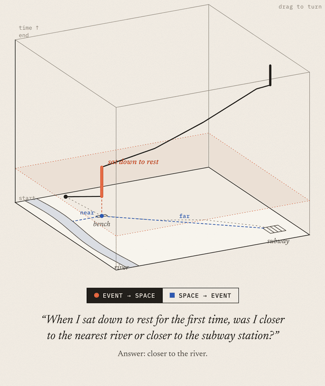
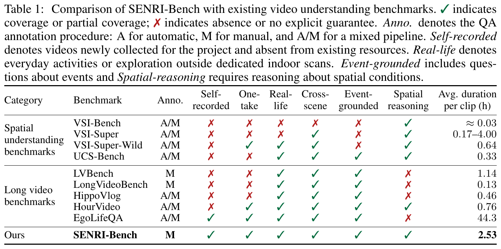
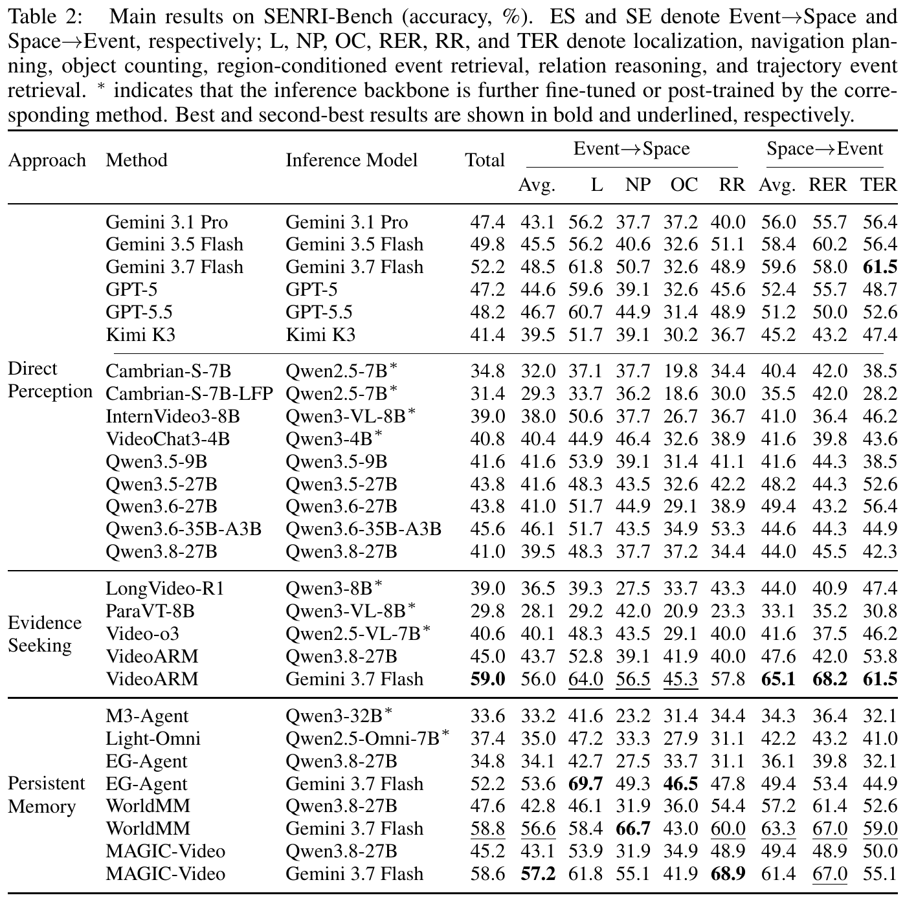
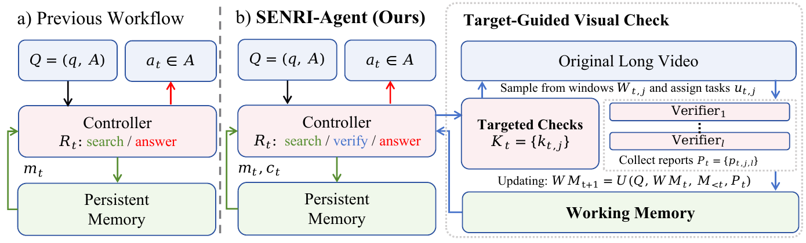

<h1 align="center">SENRI: Understanding the Space–Event Nexus in Real-Life Videos</h1>

<p align="center">
  Kehan Lan<sup>1,2</sup>, Kaining Ying<sup>1</sup>, Henghui Ding<sup>1</sup>, Kaipeng Zhang<sup>2&#42;</sup>
  <br>
  <sup>1</sup>Fudan University &nbsp;&nbsp; <sup>2</sup>Alaya Lab
  <br>
  <sup>&#42;</sup>Corresponding author
</p>

<p align="center">
  <a href=""></a>
  <a href="https://senri-video.github.io/"></a>
  <a href="https://huggingface.co/datasets/lannn2333/senri-bench/tree/main"></a>
</p>

<p align="center">
  
</p>

## Abstract

Human memories are organized in a way that connects events with their corresponding spatial contexts. An AI assistant should also be able to memorize and recall the nexus of events and spaces. Thus we introduce **SENRI**, a task that studies this space–event connection in long, continuous real-life egocentric video. It contains six task types in two directions: Event→Space, which recovers spatial knowledge from event cues, and Space→Event, which retrieves events from regions and trajectories. To evaluate this, we build **SENRI-Bench**, containing 500 manually annotated multiple-choice questions over 10 uninterrupted self-recorded videos with around 25.3 hours of content. Also, we evaluate three typical long video understanding paradigms: direct perception, evidence seeking, and persistent memory. The task remains challenging across all three paradigms, highlighting substantial room for improvement. Then we show two representative failure modes of existing memory methods and address these evidence gaps with **SENRI-Agent**, a controller that uses Target-Guided Visual Check (TGVC) to propose local visual check tasks for parallel verifiers and integrate the reports into a working memory to help with reasoning. Built upon existing memory systems, SENRI-Agent improves the performance of existing baselines without modifying their stored memories.

## SENRI-Bench

- **10 self-recorded videos, 25.3 hours.** Each one is a single uninterrupted egocentric take of real-life activity, about 2.5 hours on average. Fully new, no reusing public dataset.
- **500 manually annotated 4-option questions**, 50 per video. Each video is one evaluation episode.
- **Two directions, six task types**
- **Fairly benchmarking 28 configurations**

<p align="center">
  
</p>

We evaluated 28 configurations of three types. The strongest configurations we evaluated reach 52.2% (direct perception), 59.0% (evidence seeking) and 58.8% (persistent memory).

<p align="center">
  
</p>

### Download

```bash
huggingface-cli download lannn2333/senri-bench --repo-type dataset --local-dir senri-bench
```

```
senri-bench/
├── senri_bench_en.json
└── videos/01.mp4 … 10.mp4
```

`senri_bench_en.json` lists `videos` (`video_id`, `path`) and `questions`:

```json
{
  "qid": "01-001",
  "video_id": "01",
  "category": "spatial_event",
  "subtype": "region_conditioned_event",
  "question": "What did I do when I was opposite Starbucks?",
  "options": {"A": "...", "B": "...", "C": "...", "D": "..."},
  "answer": "A"
}
```

Report accuracy over all 500 questions, plus per direction and per task type.

## SENRI-Agent

<p align="center">
  
</p>

**The evaluation code and code of senri-agent is being cleaned up and will be released soon.**

## Citation

```bibtex
@article{lan2026senri,
  title   = {SENRI: Understanding the Space--Event Nexus in Real-Life Videos},
  author  = {Lan, Kehan and Ying, Kaining and Ding, Henghui and Zhang, Kaipeng},
  journal = {arXiv preprint},
  year    = {2026}
}
```
